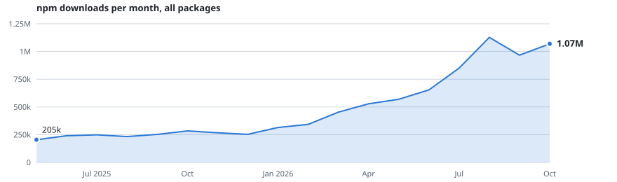

  
  

## Hi, I'm Chris 👋

Co-founder of [flyweight.io](https://flyweight.io), based in Germany.

Most of my open source starts as a fix for my own work, from AI apps and coding agents to serverless backends on AWS. When a fix is useful to others, I make it a package. Together they get more than <!-- downloads -->1M<!-- /downloads --> npm downloads a month.

<picture><source media="(prefers-color-scheme: dark)" srcset="assets/charts/downloads-total-dark.svg"></picture>

  
  
  
  
  
  
  
  
  
  
  
  

## Latest projects

<a href="https://github.com/zirkelc/tin.so"><b>tin.so</b></a>&nbsp;   
Beautiful code images. For humans and agents

<a href="https://github.com/zirkelc/agent-history"><b>Agent History</b></a>&nbsp;  
Exports your Claude Code sessions to a folder and syncs them with git

<a href="https://github.com/zirkelc/claude-quick-actions"><b>Quick Actions</b></a>&nbsp;  
One-click buttons above the Claude Code prompt for skills, prompts and shell commands

<a href="https://github.com/zirkelc/typoless"><b>Typoless</b></a>&nbsp;  
Menu bar app that fixes typos and grammar in any text field. On device, never rewrites

<a href="https://github.com/zirkelc/agent-journal"><b>Agent Journal</b></a>&nbsp;  
A journal written by your agent. It records decisions and milestones as local markdown files

## Projects

### AI SDK

Building blocks for apps that talk to LLMs, built around the [AI SDK](https://ai-sdk.dev).

<a href="https://github.com/zirkelc/ai-retry"><b>AI Retry</b></a>&nbsp;  
Retries and fallbacks for AI SDK models

<a href="https://github.com/zirkelc/ai-stream-utils"><b>AI Stream Utils</b></a>&nbsp;  
Filter and transform UI messages while streaming to the client

<a href="https://github.com/zirkelc/ai-resumable-stream"><b>AI Resumable Stream</b></a>&nbsp;  
Resume and stop UI message streams

<a href="https://github.com/zirkelc/ai-tool-set"><b>AI Tool Set</b></a>&nbsp;  
Conditional tool activations and approvals, fully type-safe

<a href="https://github.com/zirkelc/ai-assert-schema"><b>AI Assert Schema</b></a>&nbsp;  
Assert schemas (Zod, ArkType, JSON Schema) for compatibility with your AI models

<a href="https://github.com/zirkelc/ai-test-kit"><b>AI Test Kit</b></a>&nbsp;  
Mock models, content builders and stream helpers for testing AI SDK apps

<a href="https://github.com/zirkelc/chunkdown"><b>Chunkdown</b></a>&nbsp;  
Tree-based markdown text splitter for RAG that understands document structure

<a href="https://github.com/zirkelc/chunk-visualizer"><b>Chunk Visualizer</b></a>&nbsp;  
Playground to visualize and compare chunks from different text splitters

<a href="https://github.com/zirkelc/resumable-streaming-examples"><b>Resumable Streaming Examples</b></a>&nbsp;  
Streaming and resumable streaming with tRPC, TanStack Query and AI SDK

### Coding agents

Plugins, mods and skills for Claude Code and other coding agents.

<a href="https://github.com/zirkelc/agent-journal"><b>Agent Journal</b></a>&nbsp;  
A journal written by your agent. It records decisions and milestones as local markdown files

<a href="https://github.com/zirkelc/agent-history"><b>Agent History</b></a>&nbsp;  
Exports your Claude Code sessions to a folder and syncs them with git

<a href="https://github.com/zirkelc/claude-quick-actions"><b>Quick Actions</b></a>&nbsp;  
One-click buttons above the Claude Code prompt for skills, prompts and shell commands

<a href="https://github.com/zirkelc/skills"><b>Skills</b></a>&nbsp;  
My personal directory of agent skills, straight from my .claude directory

<a href="https://github.com/zirkelc/agent-plugins"><b>Agent Plugins</b></a>&nbsp;  
Marketplace for all my Claude Code plugins. Add it once, install what you want

### Apps & extensions

Things you install and use, not import.

<a href="https://github.com/zirkelc/tin.so"><b>tin.so</b></a>&nbsp;   
Beautiful code images. For humans and agents

<a href="https://github.com/zirkelc/typoless"><b>Typoless</b></a>&nbsp;  
Menu bar app that fixes typos and grammar in any text field. On device, never rewrites

<a href="https://github.com/zirkelc/heatmap"><b>Heatmap</b></a>&nbsp;  
Find the streets you never walked. Records where you go and shows it on a map

<a href="https://github.com/zirkelc/clipped-page"><b>Clipped Page</b></a>&nbsp;   
Clip any post on x.com into a self-contained, shareable URL

<a href="https://github.com/zirkelc/better-x"><b>Better X</b></a>&nbsp;  
Small but useful enhancements to x.com

### AWS & Serverless

Pieces I kept rewriting across years of serverless projects.

<a href="https://github.com/zirkelc/aws-signature-v4"><b>AWS Signature V4</b></a>&nbsp;  
Sign HTTP requests with SigV4, via aws-sigv4-fetch and aws-sigv4-sign

<a href="https://github.com/zirkelc/amazon-s3-url"><b>Amazon S3 URL</b></a>&nbsp;  
Format and parse the various Amazon S3 URL formats

<a href="https://github.com/zirkelc/middy-store"><b>Middy Store</b></a>&nbsp;  
Store and load Step Functions payloads above the 256 KB limit

<a href="https://github.com/zirkelc/serverless-exports-plugin"><b>Serverless Exports</b></a>&nbsp;  
Export env variables and stack outputs of a Serverless project to a local file

<a href="https://github.com/zirkelc/serverless-cloudwatch-logs-insights"><b>Serverless Logs Insights</b></a>&nbsp;  
Create CloudWatch Logs Insights queries for all Lambda functions

<a href="https://github.com/zirkelc/vscode-s3-extension"><b>S3 Downloader</b></a>&nbsp;  
Download and open S3 URIs directly in VS Code

### TypeScript & tooling

Small libraries, test helpers and project templates.

<a href="https://github.com/zirkelc/git-pull-run"><b>Git Pull Run</b></a>&nbsp;  
Run npm install on git pull, only when the lockfile changed

<a href="https://github.com/zirkelc/issue-watch"><b>Issue Watch</b></a>&nbsp;   
Tells you when an issue linked in a TODO comment is closed or its PR merged

<a href="https://github.com/zirkelc/expect-match-schema"><b>expect.toMatchSchema()</b></a>&nbsp;  
Check data against any Standard Schema in Vitest and Jest

<a href="https://github.com/zirkelc/snapshot-serializers"><b>Snapshot Serializers</b></a>&nbsp;  
Snapshot serializers for dynamic values in Vitest and Jest

<a href="https://github.com/zirkelc/shopify-search-query"><b>Shopify Search Query</b></a>&nbsp;  
Query builder for Shopify's GraphQL search syntax

<a href="https://github.com/zirkelc/shopify-currencies.js"><b>Shopify Currencies.js</b></a>&nbsp;  
Access Shopify's currency conversion rates from Node.js

### Hacks & PoC

Hackathon builds and experiments. Fun to make, not maintained.

<a href="https://github.com/zirkelc/AdaGPT"><b>AdaGPT</b></a> 
GitHub Action that answers on issues and PRs (GitHub + DEV 2023 Hackathon)

<a href="https://github.com/zirkelc/expect-match-prompt"><b>expect.toMatchPrompt()</b></a>&nbsp;  
An AI prompt matcher for Vitest and Jest

<a href="https://github.com/zirkelc/highlights"><b>Highlights</b></a>&nbsp;  
The same highlight extraction, in the browser without a backend

<a href="https://github.com/zirkelc/lambda-readability"><b>Lambda Readability</b></a>&nbsp;  
Reader view with Chromium and Readability.js on AWS Lambda

<a href="https://github.com/zirkelc/lambdalet"><b>Lambdalet.AI</b></a>&nbsp;  
Bookmarklet that sends a page to Lambda, an LLM extracts it, Notion stores it

<a href="https://github.com/zirkelc/PromptThis.AI"><b>PromptThis.AI</b></a>&nbsp;  
AI in the context menu (Google Chrome Built-in AI Challenge)

<a href="https://github.com/zirkelc/puppeteer-language-experiment"><b>Puppeteer Language</b></a>&nbsp;  
Methods to change the browser language with Puppeteer

<a href="https://github.com/zirkelc/pyhighlight-ocr"><b>PyHighlight OCR</b></a>&nbsp;  
Extract highlighted text from book photos with OpenCV and Tesseract

<a href="https://github.com/zirkelc/python-transcribe-youtube-whisper"><b>YouTube Whisper</b></a>&nbsp;  
Transcribe YouTube videos with Whisper in a notebook

